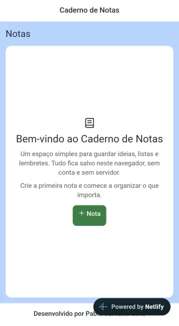
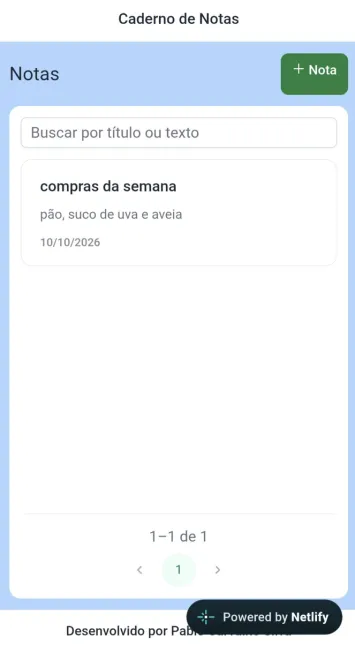
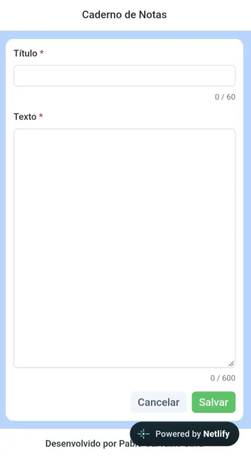
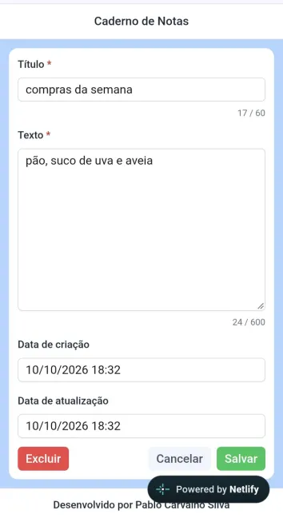

# Caderno de Notas

## Solução de Problema

Guardar uma ideia rápida não deveria exigir conta, servidor nem sincronização. O Caderno de Notas é uma aplicação de navegador para criar, editar, buscar e excluir notas neste dispositivo. Os dados ficam no `localStorage` e somem se o armazenamento do navegador for limpo.

**Demo:** [caderno-notas.netlify.app/notas](https://caderno-notas.netlify.app/notas)

## Stack

- [Angular](https://angular.dev/) 20 — componentes standalone, signals e rotas sob demanda
- [TypeScript](https://www.typescriptlang.org/) 5.9
- [PrimeNG](https://primeng.org/) 20 e [PrimeIcons](https://primefaces.org/primeicons/)
- [RxJS](https://rxjs.dev/)
- [Karma](https://karma-runner.github.io/) e [Jasmine](https://jasmine.github.io/) para testes

## Decisão técnica

A lista (`/notas`) e a criação (`/notas/nova`) são prerender. As duas rotas não dependem de um id e o HTML inicial não traz notas: no build só existe a casca da tela. Quem abre a demo recebe essa página pronta. As notas entram depois, no navegador.

A edição (`/notas/editar/:id`) renderiza no cliente. O id nasce quando a nota é gravada neste navegador. No build não há uma lista finita de ids para prerender, e o servidor não tem o texto da nota.

Os dados ficam no `localStorage` de propósito. O caderno não tem conta, servidor nem sincronização. O servidor nunca lê essa chave. O `NotasService` hidrata as notas em `afterNextRender` e só grava quando `isPlatformBrowser` é verdadeiro. Até lá, a lista mostra carregamento, não um vazio falso.

O limite é o do próprio navegador. As notas são visíveis nas ferramentas de desenvolvedor, somem se o armazenamento for limpo e não atravessam outro navegador ou outro computador. Não cabe senha, token nem nada que precise de confidencialidade. JSON corrompido ou data inválida não derruba a tela: a lista abre vazia ou sem aquela nota. Se a cota estourar, a gravação falha em silêncio e a nota segue só na memória daquela visita.

Capturas — cole as imagens aqui, por exemplo:






## Funcionalidades

- Listagem de notas com data da última atualização
- Busca por título ou texto, com sugestões de autocomplete
- Criação e edição de notas no mesmo editor
- Exclusão com confirmação
- Validação de título (obrigatório, até 60 caracteres) e texto (obrigatório, até 600 caracteres)
- Datas de criação e atualização
- Notificações de sucesso e aviso
- Persistência local no navegador

## Pré-requisitos

- [Node.js](https://nodejs.org/) 20.19+ ou 22.12+
- npm (incluído na instalação do Node.js)

## Instalação

```bash
git clone https://github.com/PabloCarvalhoSilvaDev/caderno-notas.git
cd caderno-notas
npm install
npm start
```

A aplicação fica disponível em `http://localhost:4200/`.

```bash
npm test
npm run build
```
